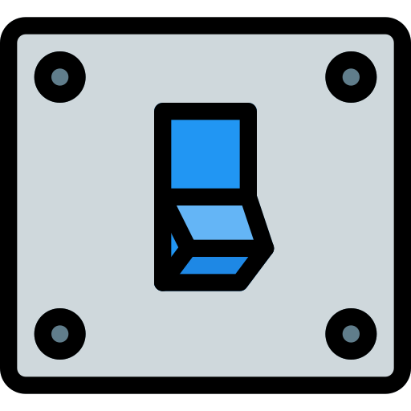

<p align="center">
  
  <h1 align="center">TrigPLC</h1>
  <p align="center">TrigPLC allows to <b>integrate</b> a Controllino device with Home Assistant using MQTT.<p>
  <p align="center">
    <a href="https://github.com/mrwolfjunior/TrigPLC/blob/master/LICENSE">
      
    </a>
    <a href="https://www.arduino.cc">
    	
    </a>
    <a href="https://www.controllino.com">
    	
    </a>
  </p>
</p>

# Features

This repo is my Controllino firmware for home automation.

Current features:

- [x] Home Assistant integration with **Device Grouping** (ESPHome-style)
- [x] **YAML-based configuration** with automatic C++ code generation
- [x] **N-to-M mapping**: multiple buttons per light and vice versa
- [x] FreeRTOS integration for real-time responsiveness
- [x] **Watchdog Timer (WDT)** for industrial-grade reliability
- [ ] Multiple press on single button (eg. double press --> 2 lights)
- [ ] OTA update 

# Brief introduction

TrigPLC is an open source firmware for the Controllino, an industry-grade PLC Arduino compatible. The firmware is optimized for ATmega2560 with Ethernet connection.

Check [Controllino webpage](https://www.controllino.com/) if you are interested.

# Why FreeRTOS

I use FreeRTOS to separate time-critical hardware logic from network communication:

- **High priority**: `TaskTrigger` manages local logic (button -> light) with sub-15ms latency.
- **Low priority**: `TaskIOT` manages MQTT connection, Home Assistant discovery, and state updates.

# Instructions

1. **Clone the repo.**
2. **Install dependencies**: Ensure you have Python with `PyYAML` and `Jinja2` installed (`pip install pyyaml jinja2`).
3. **Configure**: Copy `config.yaml.example` to `config.yaml` and customize it.
4. **Build**: Run `pio run`. PlatformIO will automatically generate `src/config.h` from your YAML.
5. **Flash**: Upload to your Controllino.

# Configuration (YAML)

The system uses a `config.yaml` file to define the hardware and logic. This approach is more readable than manual C++ editing and allows for complex mappings.

## N-to-M Mapping

You can easily map multiple buttons to a single light or use one button for multiple lights.

Example `config.yaml` mapping:

```yaml
mappings:
  - id: living_light
    name: "Living Room"
    light: relay_R0
    buttons: [btn_A0, btn_A1] # Two buttons controlling one relay
```

The code generator handles the memory-efficient C++ implementation automatically.

# Notes

- **Memory**: The project is optimized for AVR (8KB RAM). Topic strings are generated on-the-fly to save heap space.
- **Watchdog**: A hardware watchdog (8s) is active. If any task hangs, the device resets automatically.
- **HA Device**: All entities are grouped under a single "Controllino PLC" device in Home Assistant for better organization.

<p align="center">
<div>Icons made by <a href="https://www.flaticon.com/authors/pixel-perfect" title="Pixel perfect">Pixel perfect</a> from <a href="https://www.flaticon.com/" title="Flaticon">www.flaticon.com</a></div>
</p>
